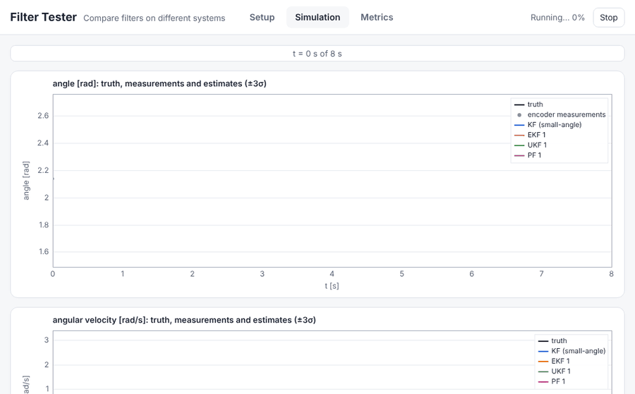
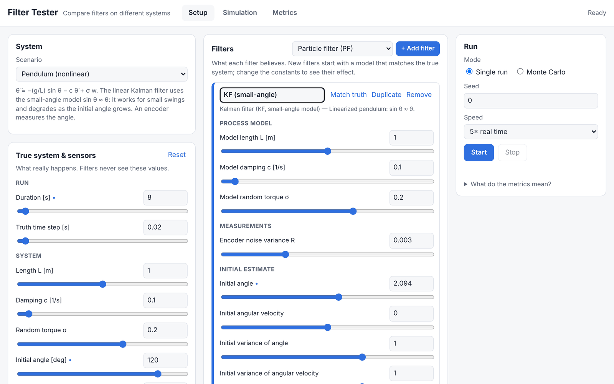
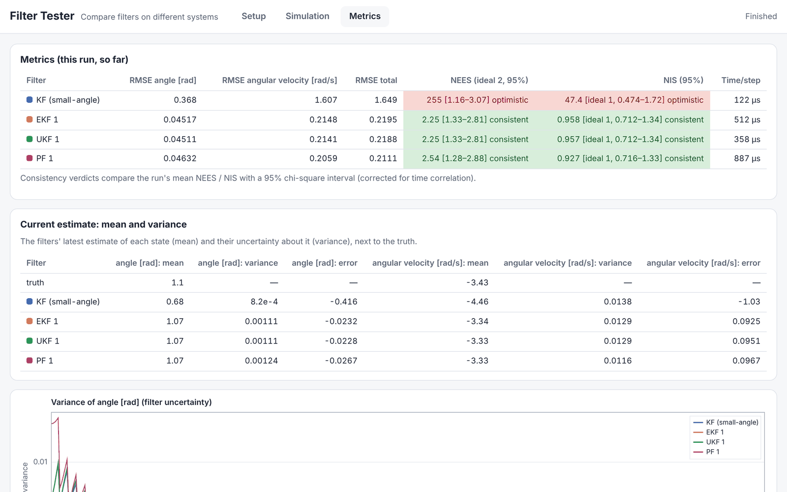
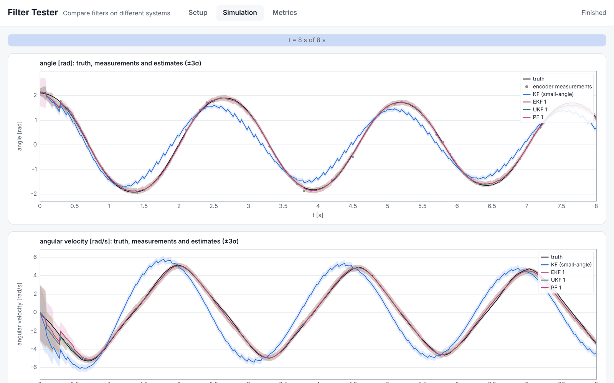

# Filter Tester

[](https://github.com/henrique-kado/Filter-tester/actions/workflows/pages.yml)
[](https://henrique-kado.github.io/Filter-tester/)

[](LICENSE)

A Python framework for testing and comparing **stochastic filters** on **different kinds of systems**, with simulated data or real recorded data. It answers questions such as *which filter is best for this system?* and *what happens when the filter's model is wrong?*

**[▶ Try the web interface](https://henrique-kado.github.io/Filter-tester/)**: pick a system, add filters, change their constants with sliders and watch the estimates and metrics live. Nothing to install.

<p align="center">
  
  <br>
  <em>A pendulum released at 120°. The linear Kalman filter (blue) relies on the small-angle model and drifts away from the truth; the EKF, UKF and particle filter follow it.</em>
</p>

## Features

- **True systems**: analytic `x = g(t, w)`, discrete-time `x_next = f(x, w, t, dt)` and SDEs `dx = f dt + G dW` (Euler–Maruyama or Heun). Noise can enter the model in any way and is easy to switch off.
- **Sensors** with their own rates (a period or explicit times). Several sensors can be fused.
- **Data sources**: simulation, with a fine truth grid plus the sensor times, or **CSV files**, one per sensor, with optional ground truth.
- **Separate truth and model**: the system that generates the data is independent from what each filter believes, so wrong dynamics, `Q` or `R` can be tested directly.
- **Filters**: linear **Kalman filter**, **extended** (EKF) and **unscented** (UKF) Kalman filters and a **particle filter**, all behind a common interface (`Filter`, `BayesFilter`).
- **Metrics**: RMSE, NEES, NIS and time per step, with chi-square **consistency verdicts** (consistent / optimistic / pessimistic).
- **Monte Carlo** experiments with per-instant chi-square bounds.
- **Plots** (matplotlib): estimates with ±3σ, errors, metric tables, NEES/NIS over time and RMSE boxplots, both static and **live** while running.
- **Web interface** that runs the package in the browser (Pyodide).

## Quick start

```bash
pip install "filter-tester[plot] @ git+https://github.com/henrique-kado/Filter-tester"
# or, from a clone:  pip install -e ".[plot]"
```

Compare two Kalman filters, one with the right GPS noise and one that trusts the GPS 25× too much:

```python
import numpy as np
from filter_tester.experiment import Runner
from filter_tester.filters import KalmanFilter
from filter_tester.metrics import format_summary
from filter_tester.models import LinearMeasurementModel, LinearProcessModel
from filter_tester.noise import GaussianNoise
from filter_tester.sensors import Sensor
from filter_tester.sources import SimulatedSource
from filter_tester.systems import DiscreteSystem

A = lambda dt: np.array([[1.0, dt], [0.0, 1.0]])                       # x = [position, velocity]
Q = lambda dt: 0.05 * np.array([[dt**3 / 3, dt**2 / 2], [dt**2 / 2, dt]])

# The true system and a GPS measuring the position every 0.5 s
system = DiscreteSystem(f=lambda x, w, t, dt: A(dt) @ x + w, x0=[0.0, 1.0], noise=GaussianNoise(Q(0.05)))
gps = Sensor("gps", lambda x, v, t: x[:1] + v, noise=GaussianNoise([[0.25]]), period=0.5)
source = SimulatedSource(system, [gps], times=np.arange(0.0, 30.0, 0.05))

def kf(R):
    return KalmanFilter(
        process=LinearProcessModel(A, Q),
        measurements={"gps": LinearMeasurementModel(H=[[1.0, 0.0]], R=[[R]])},
        x0=[0.0, 0.0],
        P0=np.eye(2),
    )

result = Runner(source, {"matched": kf(0.25), "overconfident": kf(0.01)}).run(rng=0)
print(format_summary(result, ["position", "velocity"]))
```

```
Filter         RMSE position  RMSE velocity  RMSE total  NEES (ideal 2, 95%)         NIS (95%)                              Time/step
-------------  -------------  -------------  ----------  --------------------------  -------------------------------------  ---------
matched        0.4311         0.3734         0.5703      1.7 [1.39–2.71] consistent  0.965 [ideal 1, 0.666–1.4] consistent  23.4 µs
overconfident  0.5696         0.6363         0.8539      30 [1.41–2.7] optimistic    16.7 [ideal 1, 0.675–1.39] optimistic  19.4 µs
```

The overconfident filter is less accurate (higher RMSE), and the metrics show why: its NEES is 30 instead of about 2, so it believes it is far more precise than it is.

Then plot it with `plot_estimates(result)`, `plot_errors(result)` and `plot_summary_table(result)` from `filter_tester.plotting`.

## How it works

```
 Data source ──► Steps ──────────────────► Filters ──► Trajectories ──► Metrics / Plots
 (simulated     (t, {sensor: z}, truth?)              (mean, covariance
  or CSV)                                              per step)
```

**A filter never sees where its data comes from, nor the truth.** At each step it receives only the time and the measurements taken then (possibly none), and it returns an estimate: a mean and a covariance. The truth, when known, is used only afterwards for the metrics.

## Guide

### True systems

```python
from filter_tester.systems import AnalyticSystem, DiscreteSystem, SDESystem, simulate

wave = AnalyticSystem(lambda t, w: [np.sin(t + w[0])], noise=GaussianNoise([[0.01]]))   # x = g(t, w)
ou = SDESystem(f=lambda x, t: -1.5 * x, G=lambda x, t: [0.8], x0=[2.0])                  # dx = f dt + G dW

states = simulate(system, np.arange(0.0, 10.0, 0.05), rng=42)   # (len(times), 2)
system.reset(rng=1, x0=[5.0, 0.0])                               # choose the initial state for one run
system.noise_enabled = False                                     # nominal, noiseless trajectory
system.noise_enabled = True
```

- **Interface**: every system has `reset(t0, rng, x0)` and `advance(t)`.
- **Noise**: `w` is passed to the model function, so it may enter the model in any way. A noise source is a `Noise` object (`GaussianNoise`, `UniformNoise`) or any callable `rng -> array`.
- **Initial state**: `x0` can be a fixed vector or a noise that samples a random one.
- **SDEs**: integrated in sub-steps of at most `max_step`, with `method="euler"` (Euler–Maruyama) or `method="heun"`. Heun uses a second-order drift and Itô noise, and is much more accurate for strongly nonlinear or chaotic drifts. `G` may depend on the state.
- **Labels**: `state_names=[...]` sets the axis labels used in plots.

### Sensors

```python
speed = Sensor("speed", lambda x, v, t: x[1:] + v, noise=GaussianNoise([[0.01]]), times=[1.0, 2.5, 4.0])
```

`Sensor(name, h, noise, period | times, offset)` computes `z = h(x, v, t)`. The name identifies its measurements and must be unique within a source. Noise is optional and can be switched off with `sensor.noise_enabled = False`.

### Data sources

```python
from filter_tester.core import measurement_series, truth_series
from filter_tester.sources import CSVSource

steps = SimulatedSource(system, [gps, speed], times=np.linspace(0, 10, 1001)).run(rng=0)
t, x = truth_series(steps)                  # high-resolution truth
tz, z = measurement_series(steps, "gps")

recorded = CSVSource(["examples/data/gps.csv", "examples/data/speedometer.csv", "examples/data/truth.csv"])
```

- **`SimulatedSource(system, sensors, times)`**:
  - evaluates the system on the `times` grid (the truth) and at every sensor time;
  - measurements at the same instant share one `Step`;
  - the system and each sensor have independent random streams, so switching a sensor's noise off leaves the truth unchanged for the same seed.
- **`CSVSource(files)`** reads one CSV file per sensor:
  - the time column (`t`, `time` or `timestamp`) is detected automatically, and `time_unit` converts it to seconds;
  - a column `gps.x` belongs to sensor `gps`, a column without prefix belongs to the file's name, and the group `truth` is the ground truth;
  - `CSVSource(mapping={"gps": {"file": ..., "columns": [...]}, ...})` chooses the columns explicitly;
  - empty cells mean "no sample", so sensors with different rates can share a file.

### Filters

| Filter | Belief | Nonlinearity | Cost |
|---|---|---|---|
| `KalmanFilter` | one Gaussian | linear models only (exact) | lowest |
| `ExtendedKalmanFilter` | one Gaussian | linearizes `f`, `h` with Jacobians (given or finite differences) | low |
| `UnscentedKalmanFilter` | one Gaussian | propagates `2n+1` sigma points through `f`, `h`; no Jacobians | low |
| `ParticleFilter` | `N` weighted samples | any; resampling when `N_eff` drops, optional regularization | ~`N`× higher |

```python
from filter_tester.filters import ExtendedKalmanFilter, ParticleFilter, UnscentedKalmanFilter
from filter_tester.models import MeasurementModel, ProcessModel, rk4

my_filter = KalmanFilter(
    process=LinearProcessModel(A=A, Q=Q),                 # fixed matrices, or functions of dt
    measurements={"gps": LinearMeasurementModel(H=[[1, 0]], R=[[0.25]])},
    x0=[0.0, 0.0], P0=np.eye(2),
)

# Nonlinear models: x_next = f(x, dt) + w, z = h(x) + v. vectorized=True accepts batches (N, n).
pendulum = ProcessModel(
    rk4(lambda X: np.stack([X[..., 1], -9.81 * np.sin(X[..., 0])], -1)),   # integrates dx/dt with RK4
    Q=lambda dt: 0.01 * dt * np.eye(2),
    vectorized=True,
)
encoder = {"enc": MeasurementModel(lambda X: X[..., :1], R=[[0.003]], vectorized=True)}
ekf = ExtendedKalmanFilter(pendulum, encoder, x0=[2.0, 0.0], P0=0.01 * np.eye(2))
ukf = UnscentedKalmanFilter(pendulum, encoder, x0=[2.0, 0.0], P0=0.01 * np.eye(2), alpha=1.0, beta=2.0, kappa=0.0)
pf = ParticleFilter(pendulum, encoder, x0=[2.0, 0.0], P0=0.01 * np.eye(2), n_particles=500, regularization=0.5, seed=0)
```

Filters follow `Filter.step(t, measurements) -> Estimate(t, mean, covariance)`. A `BayesFilter`:
- starts from `x0`, `P0` at the first step's time;
- then predicts by the elapsed `dt` and updates once per measurement;
- ignores sensors it has no model for.

Steps without measurements only predict, which gives estimates at the full truth resolution.

- **Linear models** work with every filter. With them, the EKF and UKF give exactly the KF's result.
- **Innovations**: every filter stores each innovation `(y, S)` in `estimate.extras["innovations"]`, which the NIS uses. The particle filter computes it from the predicted cloud.
- **Particle filter**:
  - it is random, but `seed` makes it reproducible, and `reset()` restarts the same sequence;
  - `regularization` adds a small jitter after resampling, which prevents the cloud from collapsing into copies of a few particles.

### Comparing filters

```python
from filter_tester.metrics import nees_consistency, rmse
from filter_tester.plotting import LiveFilterPlot, plot_errors, plot_estimates, plot_summary_table

runner = Runner(source, {"matched": kf(0.25), "overconfident": kf(0.01)})
live = LiveFilterPlot(labels=["position", "velocity"], speed=None)   # speed=1.0: real time
result = runner.run(rng=0, observers=[live])
live.finish()

rmse(result["matched"]), nees_consistency(result["matched"]).verdict
plot_estimates(result, ["position", "velocity"])
plot_errors(result, ["position", "velocity"])
plot_summary_table(result, ["position", "velocity"])
```

- **`Runner(source, filters).run(rng, x0, observers)`** gives every filter the same steps and returns a `RunResult`.
- **`result[name]`** is a `Trajectory` with arrays `t`, `mean`, `covariance`, `std`, `truth`, `error`, `innovations` and `step_time`.
- **Observers** are called after every step.

### Monte Carlo

```python
from filter_tester.experiment import MonteCarlo
from filter_tester.metrics import format_mc_summary
from filter_tester.plotting import LiveMonteCarloPlot, plot_mc_consistency, plot_mc_summary_table, plot_rmse_boxplot

mc = MonteCarlo(source, {"matched": kf(0.25), "overconfident": kf(0.01)}, runs=50)   # run k uses seed k
result = mc.run()                 # observers=[LiveMonteCarloPlot()] to watch it; keep_runs=True keeps every run
print(format_mc_summary(result, ["position", "velocity"]))
plot_mc_consistency(result)       # NEES / NIS averaged over runs, with chi-square bounds
plot_rmse_boxplot(result, ["position", "velocity"])
```

Any single run can be reproduced with `Runner(...).run(rng=k)`. `first_seed=` starts an independent experiment.

### Plotting systems

```python
from filter_tester.plotting import plot_states, plot_system

fig, axes, states = plot_system(system, np.arange(0, 10, 0.05), rng=0, live=False)   # live=True, speed=1.0
plot_states(np.arange(0, 10, 0.05), simulate(system, np.arange(0, 10, 0.05), rng=1), axes=axes)
```

## Metrics

| Metric | Measures | Needs truth | Ideal |
|---|---|---|---|
| RMSE | accuracy: distance between estimate and truth | yes | lower is better |
| NEES | whether the covariance matches the actual error | yes | mean ≈ state dimension `n` |
| NIS | whether the innovation covariance matches the innovations | **no**, so it works on real data | mean ≈ measurement dimension |
| Time/step | computational cost | no | lower is better |

The verdicts compare the mean NEES / NIS with a 95% chi-square interval:
- **consistent**: the mean is inside the interval;
- **optimistic**: the mean is above it, so the filter is overconfident and underestimates its error;
- **pessimistic**: the mean is below it, so the filter overestimates its error.

**Single run.** Samples are correlated in time, so the interval uses an effective sample size estimated from the autocorrelation. Without this correction, a filter with the exact model was flagged in about 75% of runs on a fine truth grid; with it, about 5–8% are flagged, close to the nominal 5%.

**Monte Carlo.** At every instant, the NEES (NIS) averaged over N independent runs is checked against `chi2(N·n)/N`. A consistent filter stays inside the bounds at about 95% of the instants. In 50 experiments of 20 runs each:
- the matched filter stayed inside 96% of the time;
- optimistic and pessimistic filters were flagged in all 50;
- the overall ANEES verdict over-flags a matched filter somewhat (about 14% instead of 5%), so prefer the per-instant check.

## Web interface

**https://henrique-kado.github.io/Filter-tester/**

| Setup | Metrics |
|---|---|
|  |  |



- **Setup**:
  - choose a system and its true constants and sensors;
  - add any mix of **KF, EKF, UKF and particle filters**, and tune each one's model, `Q`, `R` and initial estimate (plus α/β/κ for the UKF; particles, resampling and regularization for the PF) with sliders or typed values. New filters start matched to the truth, and *Match truth* resets them.
- **Simulation**:
  - **single run**: truth, measurements and estimates ±3σ, live and optionally in real time;
  - **Monte Carlo**: NEES/NIS averaged over the runs, with their bounds.
- **Metrics**:
  - RMSE, NEES, NIS and time per step with verdicts;
  - in a single run, each filter's current mean and variance, and the variance over time;
  - in Monte Carlo, the mean and variance of the per-run RMSE, and its boxplots.

| Scenario (`filter_tester.scenarios`) | True system | Filter models |
|---|---|---|
| Constant velocity | random acceleration; GPS, optional speedometer | exact |
| Ornstein–Uhlenbeck | `dx = −θx dt + σ dW` | exact discretization |
| Mass–spring–damper | damped oscillator, random force | exact discretization |
| Pendulum (nonlinear) | `θ̈ = −(g/L) sin θ − cθ̇ + σw` | KF: small-angle `sin θ ≈ θ`, which degrades at large angles; EKF/UKF/PF: nonlinear model |
| Lorenz (chaotic) | `ẋ = σ(y−x)`, `ẏ = x(ρ−z)−y`, `ż = xy−βz` + noise | EKF, UKF and PF only |

The page runs this package with [Pyodide](https://pyodide.org). The first visit downloads Python, numpy and scipy, which takes a few seconds. To run it locally with regular Python, use `python web/dev_server.py` and open `http://localhost:8000/?backend=server`.

## Examples

| Script | Shows |
|---|---|
| `examples/plot_systems.py` | the three kinds of system, live or static (`--static`, `--speed 1`) |
| `examples/simulated_source.py` | two sensors at different rates over a high-resolution truth |
| `examples/csv_source.py` | reading the sample CSV files in `examples/data/` |
| `examples/kalman_filter.py` | a Kalman filter on the CSV data, ±3σ vs. truth |
| `examples/compare_filters.py` | matched vs. optimistic vs. pessimistic filters, live, then figures and table |
| `examples/monte_carlo.py` | the same comparison over 100 runs (`--runs N`, `--static`) |
| `examples/nonlinear_filters.py` | KF vs. EKF vs. UKF vs. PF on the pendulum (small and large swing) and on the Lorenz system |

## Extending

- **New filter**: subclass `Filter` (`reset`, `step`) or `BayesFilter` (`predict(dt)`, `update(sensor, z)`, `knows_sensor(sensor)`). It then works with the `Runner`, the metrics, the plots and Monte Carlo.
- **New system**: pass your own functions to `AnalyticSystem`, `DiscreteSystem` or `SDESystem`, or subclass `System` (`_initial_state`, `_advance`).
- **New metric**: a function of a `Trajectory`.
- **New scenario in the web interface**: add a `Scenario` to `filter_tester/scenarios.py`, with its parameters and filter types.

## Project layout

```
src/filter_tester/
  core/          Step, Estimate
  systems/       AnalyticSystem, DiscreteSystem, SDESystem, simulate
  noise.py       GaussianNoise, UniformNoise
  sensors/       Sensor
  sources/       SimulatedSource, CSVSource
  models/        LinearProcessModel, LinearMeasurementModel, ProcessModel, MeasurementModel, rk4
  filters/       Filter, BayesFilter, KalmanFilter, ExtendedKalmanFilter, UnscentedKalmanFilter, ParticleFilter
  experiment/    Runner, MonteCarlo, Trajectory
  metrics/       RMSE, NEES, NIS, consistency, summary tables
  plotting/      static and live matplotlib plots (optional dependency)
  scenarios.py   ready-made systems + filter models (used by the web interface)
  web_api.py     JSON API for the web interface
examples/        runnable scripts and sample data
web/             web interface: page, canvas charts, build script, dev server
tests/           pytest suite, including end-to-end tests of the web interface
docs/images/     screenshots used in this README
```

## Development

```bash
pip install -e ".[dev]"                  # pytest, matplotlib and ruff
ruff check . && ruff format --check .    # lint and formatting (also run in CI)
pytest                                   # the UI tests are skipped without Playwright + Chrome
pip install -e ".[ui-test]"              # adds Playwright for tests/test_web_ui.py
python web/dev_server.py                 # local web interface: http://localhost:8000/?backend=server
python web/build.py                      # builds the static site into web/dist/
```

On every push to `main`, `.github/workflows/pages.yml` lints the code, runs the tests, builds the site and deploys it to GitHub Pages. This requires *Settings → Pages → Source: GitHub Actions*.

## Roadmap

- Control inputs
- More filters, e.g. square-root and ensemble Kalman filters, and smoothers (RTS)
- Non-Gaussian measurement noise in the particle filter

## License

[MIT](LICENSE)
